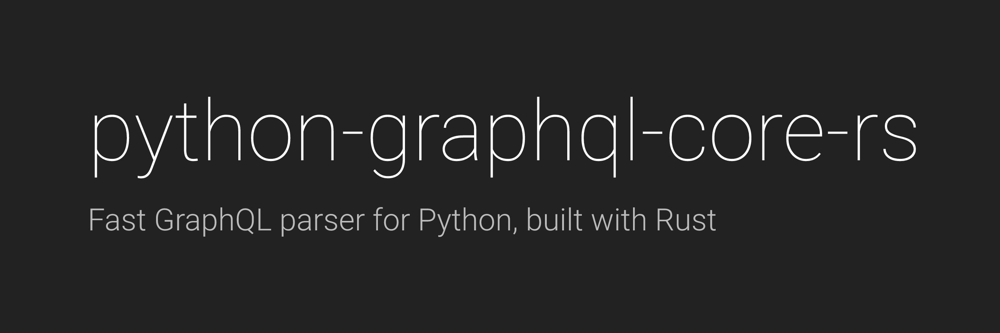

<p align="center"></p>

<p align="center"><strong>Fast GraphQL parser for Python, built with Rust</strong></p>

<p align="center"><a href="https://github.com/conao3/python-graphql-core-rs/actions/workflows/CI.yml"></a> <a href="https://github.com/conao3/python-graphql-core-rs/releases"></a> <a href="LICENSE"></a> <a href="https://github.com/conao3/python-graphql-core-rs/stargazers"></a></p>

<p align="center"><a href="#installation">Installation</a> | <a href="#usage">Usage</a> | <a href="#development">Development</a> | <a href="#license">License</a></p>

<h1>python-graphql-core-rs</h1>

A high-performance GraphQL parser for Python, powered by Rust.

This library provides Python bindings to the [graphql-parser](https://crates.io/crates/graphql-parser) Rust crate, offering fast and reliable GraphQL query parsing through native extensions.

## Features

- Fast GraphQL query parsing using Rust's graphql-parser
- Native Python extension built with PyO3
- Supports Python 3.11+ (CPython and PyPy)

## Installation

### From Source

Requires [Rust](https://rustup.rs/) and [Maturin](https://github.com/PyO3/maturin):

```bash
pip install maturin
maturin develop
```

## Usage

```python
import graphql_core_rs

# Parse a GraphQL query
query = """
query GetUser($id: ID!) {
    user(id: $id) {
        name
        email
    }
}
"""

result = graphql_core_rs.parse(query)
print(result)
```

## Development

Build the extension in development mode:

```bash
pip install -r requirements.txt
maturin develop
```

Run with release optimizations:

```bash
maturin develop --release
```

## Release

Run the Release workflow from `master`:

```bash
gh workflow run release.yml --ref master -f version_bump=patch
```

The run bumps the version in `Cargo.toml` and `Cargo.lock`, pushes the version commit to `master` together with the annotated tag `v<version>`, builds the wheels and the sdist from that tag, publishes them to PyPI as `python-graphql-core-rs` with trusted publishing (environment `pypi`), and creates the GitHub Release.

## Requirements

- Python 3.11+
- Rust toolchain
- Maturin 1.15.x

## License

Apache-2.0
